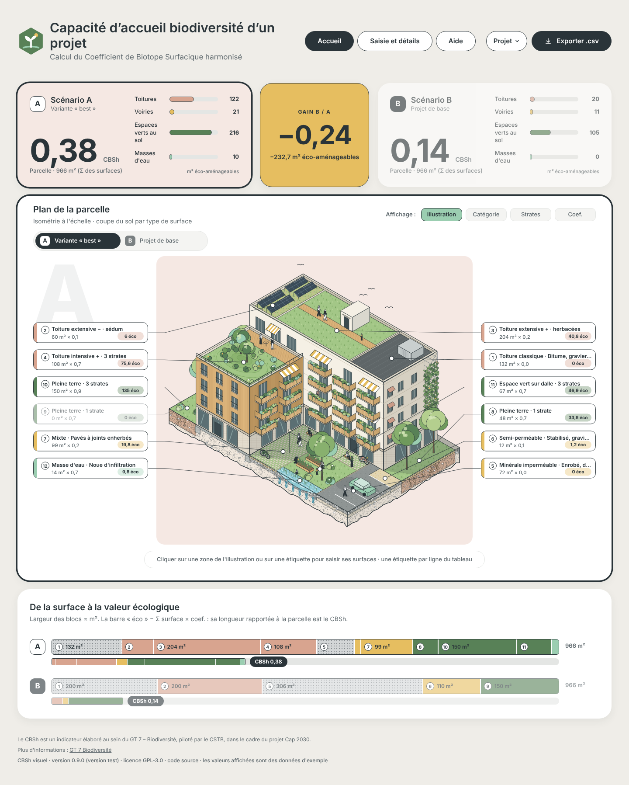
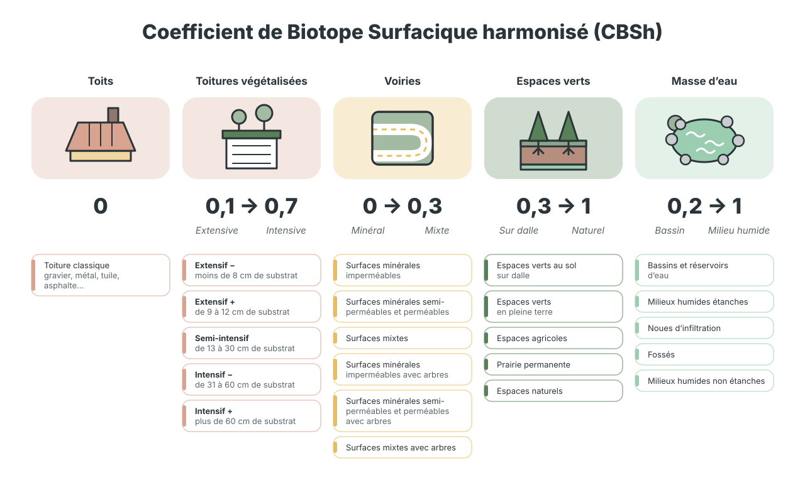
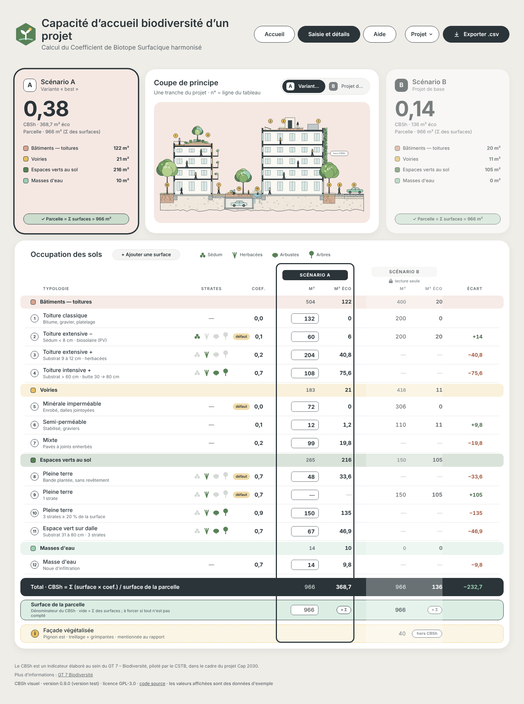
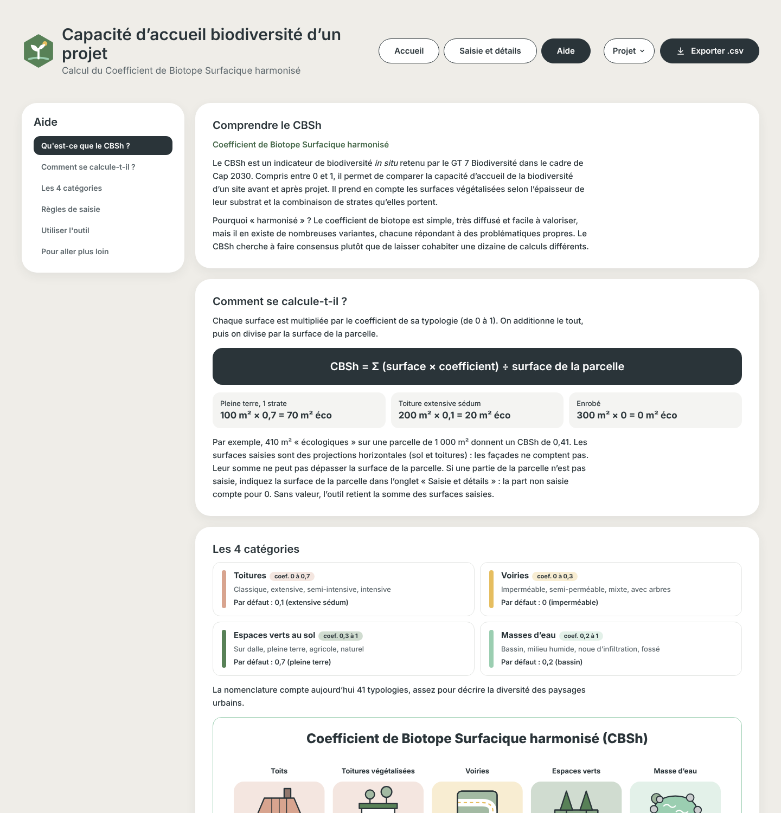
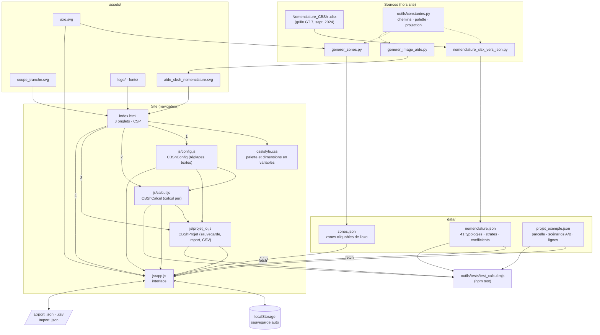

# CBSh — Biotope de la parcelle

Outil web gratuit de calcul et de comparaison du **CBSh** (coefficient de biotope surfacique harmonisé) pour **deux scénarios d'un même projet** (par exemple « projet de base » et « variante best »).

**▶ Utiliser l'outil : [https://alliages.github.io/cbsh_visuel/](https://alliages.github.io/cbsh_visuel/)**

<p align="center">
  
</p>

- Version : voir `VERSION` · historique : `CHANGELOG.md` · suite : `ROADMAP.md`
- Licence : GPL-3.0 (`LICENSE`)
- **Version 0.9.0 : version test.** Les valeurs affichées au démarrage sont des données d'exemple. Retours bienvenus avant la première version annoncée (1.0).

> Le CBSh est un indicateur élaboré au sein du GT 7 – Biodiversité, piloté par le CSTB, dans le cadre du projet Cap 2030 (nomenclature de septembre 2024). L'outil en ligne du CSTB est propriétaire : seule la méthode est reprise ici.

## Sommaire
- [Partie 1 — Pour les utilisateurs](#partie-1--pour-les-utilisateurs)
- [Partie 2 — Pour les développeurs](#partie-2--pour-les-développeurs)

---

# Partie 1 — Pour les utilisateurs

Aucune installation, aucun compte : ouvrir le lien ci-dessus dans un navigateur récent. Vos données restent dans votre navigateur (rien n'est envoyé à un serveur).

## 1. Qu'est-ce que le CBSh ?

Le CBSh est un indicateur de biodiversité *in situ* retenu par le GT 7 Biodiversité dans le cadre de Cap 2030. Compris entre 0 et 1, il permet de comparer la capacité d'accueil de la biodiversité d'un site avant et après projet. Il prend en compte les surfaces végétalisées selon l'épaisseur de leur substrat et la combinaison de strates qu'elles portent. Il est « harmonisé » : il cherche à faire consensus plutôt que de laisser cohabiter une dizaine de calculs de coefficient de biotope différents.

## 2. Comment se calcule-t-il ?

Chaque surface est multipliée par le coefficient de sa typologie (de 0 à 1). On additionne le tout, puis on divise par la surface de la parcelle :

```
CBSh = Σ (surface × coefficient) ÷ surface de la parcelle
```

| Exemple | Calcul |
|---|---|
| Pleine terre, 1 strate | 100 m² × 0,7 = 70 m² éco |
| Toiture extensive sédum | 200 m² × 0,1 = 20 m² éco |
| Enrobé | 300 m² × 0 = 0 m² éco |

Par exemple, 410 m² « écologiques » sur une parcelle de 1 000 m² donnent un CBSh de 0,41.

- Les surfaces saisies sont des **projections horizontales** (sol et toitures) : **les façades ne comptent pas**.
- Leur somme **ne peut pas dépasser** la surface de la parcelle. Si une partie de la parcelle n'est pas saisie, indiquez la surface de la parcelle dans l'onglet « Saisie et détails » : la part non saisie compte pour 0. Sans valeur, l'outil retient la somme des surfaces saisies.

## 3. Les 4 catégories

| Catégorie | Coefficients | Typologies | Par défaut |
|---|---|---|---|
| Toitures | 0 à 0,7 | classique, extensive, semi-intensive, intensive | 0,1 (extensive sédum) |
| Voiries | 0 à 0,3 | imperméable, semi-perméable, mixte, avec arbres | 0 (imperméable) |
| Espaces verts au sol | 0,3 à 1 | sur dalle, pleine terre, agricole, naturel | 0,7 (pleine terre) |
| Masses d'eau | 0,2 à 1 | bassin, milieu humide, noue d'infiltration, fossé | 0,2 (bassin) |

La nomenclature compte 41 typologies. La figure ci-dessous, issue de l'aide intégrée, en donne la vue d'ensemble.

<p align="center">
  
</p>

## 4. Quelques règles de saisie

1. Une strate **arbustive ou arborée** ne compte que si elle couvre **au moins 20 %** de la surface.
2. La mention « **avec arbres** » demande plus de 2 arbres pour 100 m².
3. La **pleine terre** exclut tout revêtement, même perméable, ainsi que toute dalle ou interface imperméable en profondeur.
4. Si vous ne connaissez pas la typologie exacte, « **Je ne sais pas** » applique le coefficient par défaut de la catégorie.

## 5. Utiliser l'outil

L'outil compte trois onglets : **Accueil**, **Saisie et détails** et **Aide** (l'aide intégrée reprend les points 1 à 4 ci-dessus). L'en-tête propose aussi le menu **Projet** et le bouton **Exporter .csv**.

### Onglet Accueil : voir et saisir sur le plan

- **Deux cartes de résultat** (scénarios A et B) affichent le CBSh, la contribution de chaque catégorie en m² éco-aménageables, et la carte centrale le **gain** entre les deux scénarios.
- Le **scénario actif** (celui que vous modifiez) est entouré d'un cadre épais ; l'autre est estompé. On bascule d'un scénario à l'autre en cliquant sur sa carte ou dans le sélecteur au-dessus du plan. Le nom d'un scénario se modifie d'un clic.
- Le **plan de la parcelle** est une axonométrie illustrée. Chaque zone représente une grande catégorie ; **cliquez sur une zone ou sur une étiquette** (une étiquette par ligne du tableau) pour saisir ses surfaces. Les zones à 0 m² dans le scénario actif sont grisées.
- La **mosaïque** en bas de page montre, par scénario, de la surface à la valeur écologique : la largeur des blocs est proportionnelle aux m², et la longueur de la barre « éco » rapportée à la parcelle est le CBSh.

### La fenêtre de saisie

<p align="center">
  
</p>

Selon la catégorie, la fenêtre propose l'épaisseur de substrat (toitures), les strates présentes (sédum, herbacées, arbustes, arbres), la surface et le résultat immédiat (typologie, coefficient, m² éco). « Je ne sais pas » applique le coefficient par défaut. **Valider dans A** (ou B) enregistre ; **Annuler** ferme sans rien changer. Seul le scénario actif est modifiable.

### Onglet Saisie et détails : le tableau complet

<p align="center">
  
</p>

- **Coupe de principe** du projet : les numéros correspondent aux lignes du tableau.
- **Tableau « Occupation des sols »** : une ligne par typologie, regroupées par catégorie avec sous-totaux. Le scénario actif est en saisie, l'autre en lecture seule, avec l'écart en m² éco.
- **Total** et contrôle « Σ surfaces = parcelle ». La **surface de la parcelle** peut être forcée (par défaut : somme des surfaces).
- **+ Ajouter une surface** crée une ligne ; une ligne vide dans les deux scénarios peut être supprimée (✕).
- **Façade végétalisée** : indicative, **hors CBSh** (contribution nulle), avec possibilité de la mentionner au rapport.

### Enregistrer, exporter, importer

- Vos saisies sont **enregistrées automatiquement dans le navigateur** : elles sont retrouvées au rechargement, mais ne passent pas d'un appareil à un autre (ni d'un navigateur à un autre).
- Menu **Projet** : exporter le projet (`.json`), importer un projet, revenir à l'exemple (deux clics, par sécurité). Un fichier importé est entièrement contrôlé ; s'il est refusé, rien n'est écrasé et le message indique les motifs.
- Bouton **Exporter .csv** : une ligne par surface plus une synthèse, directement lisible dans Excel en français (séparateur « ; », virgule décimale).
- Pour travailler à plusieurs ou changer d'appareil : passer par l'export / import `.json`.

### Aide intégrée

<p align="center">
  
</p>

## 6. Pour aller plus loin

[Livrable de la phase 1 du GT 7 Biodiversité (novembre 2024)](https://www.planbatimentdurable.developpement-durable.gouv.fr/IMG/pdf/cap2030_gt7-biodiversite_phase_1_vdiffusion.pdf) : présentation détaillée du CBSh, choix de construction et tutoriel de l'outil officiel.

---

# Partie 2 — Pour les développeurs

## Principes

- **Site statique** HTML / CSS / JavaScript, **aucune dépendance** d'exécution, aucune étape de build : publié tel quel sur GitHub Pages depuis `main`, sans GitHub Action.
- Scripts classiques (pas de modules ES) : le site s'ouvre aussi depuis un fichier, mais les données sont chargées par `fetch` ; il faut donc le **servir** en local.
- Le calcul (`calcul.js`) et la validation / export (`projet_io.js`) sont **purs** (sans accès au DOM) et testés avec Node.
- Python ne sert qu'à l'**outillage hors site** : conversion de la nomenclature, génération des zones cliquables et de la figure d'aide.

## Lancer en local

Depuis PowerShell, à la racine du dépôt :

```powershell
python -m http.server 8000
```

puis ouvrir http://localhost:8000/ .

## Tests

```powershell
npm test
```

Node ≥ 20, aucune dépendance : nomenclature, calcul (cas de référence calculé à la main), validation d'import, CSV, cohérence des données et de la configuration (`outils/tests/test_calcul.mjs`).

## Organigramme : fichiers et flux de données



Ordre de chargement des scripts dans `index.html` : `config.js` → `calcul.js` → `projet_io.js` → `app.js`. Chacun expose un objet global (`CBShConfig`, `CBShCalcul`, `CBShProjet`) lu par les suivants.

## Arborescence détaillée

```
cbsh_visuel/
├── index.html                       page unique : 3 onglets (Accueil, Saisie et détails, Aide), politique de sécurité de contenu
├── VERSION                          numéro de version (repris dans le pied de page)
├── CHANGELOG.md · ROADMAP.md        historique des versions · seule liste de suivi (idées, à faire)
├── LICENSE · package.json · .gitignore
│
├── css/
│   └── style.css                    mise en page ; palette et dimensions en variables de :root, en tête
│
├── js/
│   ├── config.js                    réglages et textes modifiables, sans logique : à lire en premier
│   ├── calcul.js                    calcul CBSh pur et testé : indexerTypologies, strateValide, zoneDeLigne,
│   │                                calculerScenario, ecartScenarios, verifierDonnees
│   ├── projet_io.js                 pur et testé : enveloppe de sauvegarde, validation d'un projet importé,
│   │                                génération du CSV, noms de fichiers
│   └── app.js                       interface : onglets, rendu, saisie, bascule A/B, étiquettes, zones cliquables,
│                                    grisage, popups, menu Projet, aide
│
├── data/
│   ├── nomenclature.json            nomenclature de septembre 2024 : catégories, strates, typologies, coefficients
│   │                                (généré depuis l'Excel)
│   ├── projet_exemple.json          parcelle, scénarios A et B, lignes d'exemple (format aussi utilisé par l'export / import)
│   └── zones.json                   zones cliquables de l'axonométrie (généré) : type, catégorie, lignes, ancre
│
├── assets/
│   ├── axo.svg                      axonométrie illustrée du projet (fond du plan de l'Accueil)
│   ├── coupe_tranche.svg            coupe de principe (onglet Saisie)
│   ├── aide_cbsh_nomenclature.svg   figure de l'aide (générée)
│   ├── logo/                        logo, favicon.svg / .ico, apple-touch-icon
│   └── fonts/                       police Inter (woff2) et sa licence
│
├── outils/                          outillage Python hors site + tests
│   ├── constantes.py                chemins, palette, projection isométrique (partagés)
│   ├── nomenclature_xlsx_vers_json.py   grille Excel → data/nomenclature.json
│   ├── generer_zones.py             contours en mètres → data/zones.json
│   ├── generer_image_aide.py        → assets/aide_cbsh_nomenclature.svg
│   ├── requirements.txt             openpyxl (conversion Excel seulement)
│   └── tests/test_calcul.mjs        tests Node (npm test)
│
└── docs/                            captures d'écran du README
```

## Fonctionnement technique

1. **Démarrage** : `app.js` charge par `fetch` la nomenclature, le projet d'exemple et les zones, puis contrôle leur cohérence (`verifierDonnees`). S'il existe une sauvegarde locale valide, elle remplace l'exemple ; sinon l'exemple est affiché et **rien n'est écrit avant la première modification**.
2. **Modèle de données** : un projet est `{ nom, parcelle, scenarios, facade_vegetalisee, lignes }`. `scenarios` liste A et B (clé, nom, `surface_parcelle` forcée ou `null`). Une ligne porte un numéro `n`, une `typologie` (identifiant dans `nomenclature.json`), une `precision`, ses `strates`, une zone mémorisée (`zone`, prioritaire sur les listes de `zones.json`) et ses `surfaces: { A, B }`.
3. **Calcul** : `calculerScenario(lignes, typologies, scenario, surfaceForcee)` renvoie surface saisie, parcelle retenue, m² éco, CBSh et contributions par catégorie. `ecartScenarios` donne le gain. Règle de la parcelle : Σ surfaces ≤ parcelle forcée (tolérance en config) ; sans valeur forcée, parcelle = Σ surfaces.
4. **Zones cliquables** : `generer_zones.py` projette en isométrie des contours exprimés en mètres (`P(x, y, z) = (652 + (x − y)·cos 30°·15 ; 335 + (x + y)·7,5 − z·15)`) et écrit les chemins SVG dans `zones.json`. Types : `saisie`, `info`, `inerte`, `facade`. Toute ligne du projet doit appartenir à une zone.
5. **Grisage** : un calque grisé recouvre l'axonométrie, une copie en couleur est découpée sur la zone sélectionnée (`clip-path`). Le calque n'est refait que lorsque la liste des zones à 0 m² change.
6. **Sauvegarde** : `localStorage`, différée de 400 ms après la dernière modification et écrite à la fermeture de la page. Une sauvegarde illisible est ignorée (message), sans bloquer l'outil.
7. **Import / export** : `validerProjet` refuse tout fichier incohérent (typologies inconnues, strates incompatibles, surfaces négatives ou démesurées, numéros dupliqués, ligne sans zone…) sans rien écraser. L'export CSV est prévu pour Excel en français (« ; », virgule décimale, UTF-8 avec BOM, CRLF) et neutralise les textes commençant par `= + - @`.
8. **Sécurité** : politique de sécurité de contenu (`<meta http-equiv="Content-Security-Policy">`) limitant scripts, polices, images et requêtes au site lui-même ; liens externes en `rel="noopener noreferrer"`.

## Réglages

Les valeurs que l'on peut vouloir modifier (chemins des données, seuils, dimensions du plan de l'Accueil, longueurs maximales, délais, messages d'état) sont dans `js/config.js`. La palette et les dimensions de la mise en page sont dans les variables de `:root` de `css/style.css` (palette : Fern `#588157`, Celadon `#9bceb1`, Jet Black `#2a3439`, Metallic Gold `#e6be60`, Light Bronze `#d8a48f`). Côté Python : `outils/constantes.py`.

## Régénérer les données et figures

```powershell
# Nomenclature (depuis la grille Excel du GT 7)
pip install -r outils/requirements.txt
python outils/nomenclature_xlsx_vers_json.py chemin\vers\20240902_Nomenclature_CBSh_Diffusion_.xlsx

# Zones cliquables de l'axonométrie (aucune dépendance)
python outils/generer_zones.py

# Figure de l'aide (aucune dépendance)
python outils/generer_image_aide.py
```

## Conventions du projet

- Noms et commentaires en français ; variables et réglages en tête de fichier ; code commenté, surtout pour les traitements longs.
- Versions : dernier chiffre pair = évolution, impair = correction ; `VERSION`, `CHANGELOG.md` et `ROADMAP.md` mis à jour à chaque version.
- Aucune GitHub Action ni déploiement sans accord explicite.
